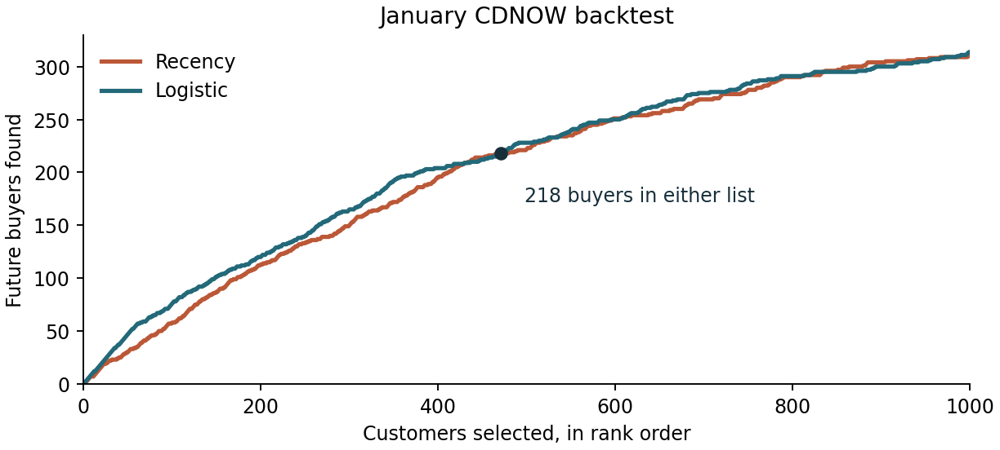

# Samuel Vempala

I’m a data scientist working on credit risk and transaction data at Capital One. I started at PayPal, looking at which customers came back. At American Express, the questions shifted to suspicious payments and what customers were trying to tell us. These days I spend as much time checking the data behind a score as I do building the model.

I have a master’s in data science from the University of North Texas and I’m pursuing an Executive PhD in IT with a focus on artificial intelligence at the University of the Cumberlands.

## Three projects to start with

**[Who comes back for another order?](projects/repeat-purchase/)**  
A retailer has room for 471 customers on a list. In the winter CDNOW backtest, a five-feature model and a simple recency rule each found 218 people who bought again. The model ranked the full cohort better. At that particular cutoff, the extra complexity bought nothing.

**[Where did the extra 69 milliseconds go?](projects/release-latency/)**  
In a simulated release, one catalog endpoint slowed down. I followed the delay from the request log into individual traces, then tested the finding on fresh requests. The repo includes the SQL join, the interval around the slowdown, and a replay of the cache change.

**[What should a banking support router send to a person?](projects/banking-intents/)**  
A small text classifier can route most of the questions in BANKING77. The interesting errors are the close calls. A cash withdrawal at the wrong exchange rate sounds a lot like a card payment at the wrong exchange rate. The error table shows where the router still mixes them up.

## More work

| Project | The decision |
| --- | --- |
| [Credit score calibration](projects/credit-calibration/) | Which model ranks historical cases well, and which gives more accurate probabilities? |
| [Fraud review under a daily limit](projects/fraud-review/) | What does a second set of ten review slots buy in a simulated queue? |
| [Supermarket sales in Tableau](projects/supermarket-sales/) | Would a 7.1% gap in member spending justify testing an offer? |
| [Reconciling payment events](projects/payment-reconciliation/) | Which mismatches disappear when late refunds arrive, and which need investigation? |

These are independent portfolio studies. CDNOW, South German Credit, and BANKING77 are published datasets. The retail records, release traffic, fraud events, and payment ledger are fictional. Each project links its inputs or includes the fixture that generates them.

[Reproduce the analyses](RUNNING.md)
