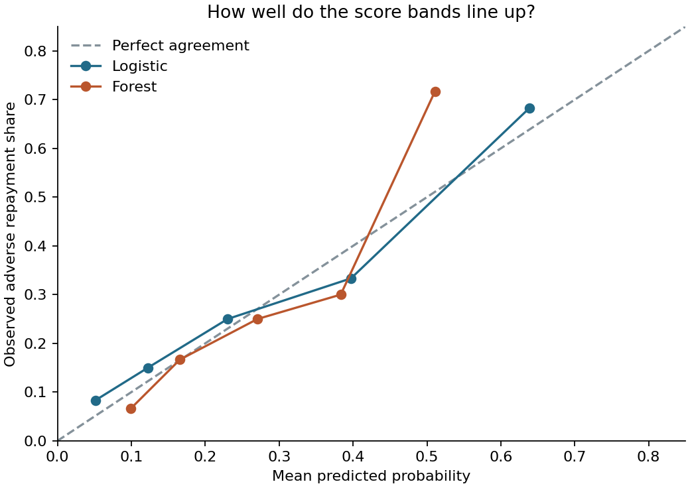

# A credit score can rank well and still miss the probability

On 300 held-out historical credit records, the random forest had a small edge in ranking. Logistic regression gave the lower overall probability error. Those two results matter for different uses of a score.

| Model | ROC AUC ↑ | Brier score ↓ |
| --- | ---: | ---: |
| Predict the training sample rate for everyone | 0.500 | 0.210 |
| Logistic regression | 0.783 | 0.163 |
| Random forest | 0.788 | 0.168 |

The dotted line marks agreement between predicted and observed rates. Each dot summarizes approximately 60 cases, so a handful of outcomes can move it. The Brier score averages squared probability errors and reflects both discrimination and calibration. A single split is too small to settle which model generally wins.

### What went into the comparison

The corrected South German Credit dataset covers 1,000 historical loans. I used six application fields covering checking-account status, credit history, savings, loan purpose, duration, and amount. Categorical codes are one-hot encoded. Both pipelines train on the same 700 records and use a fixed stratified holdout. The source deliberately oversampled adverse outcomes. All probabilities and score bands refer to this historical sample. Estimating present-day portfolio risk would require representative, dated data and an independent validation period.

[Model code](analyze.py) · [Holdout metrics](scores.csv) · [Reliability groups](bands.csv) · [Reproduction instructions](../../RUNNING.md)

Data from Ulrike Grömping’s South German Credit dataset, UCI Machine Learning Repository, CC BY 4.0. [Dataset and documentation](https://archive.ics.uci.edu/dataset/522/south+german+credit)
