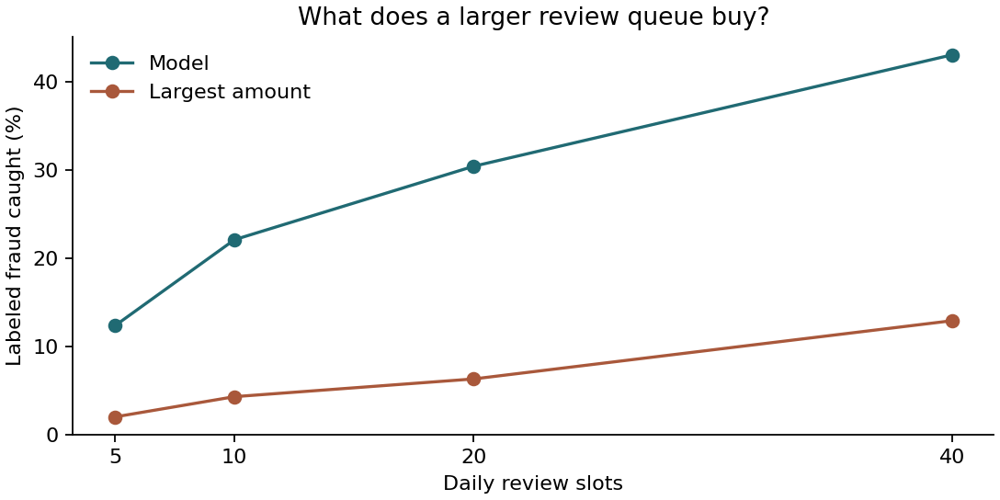

# A fraud queue with ten reviews a day

A reviewer has time for ten cases after each day closes. Over 20 simulated days, sorting by a gradient-boosted risk score found **77 of 348 labeled events** in 200 reviews. Sorting the same transactions by amount found **15**. Both policies use the same daily capacity, including on quiet days.

The next ten slots per day cost another 200 reviews and uncovered 29 additional events. That is a 14.5% hit rate for the extra work, compared with 38.5% for the first ten slots. Staffing decisions would also need loss amounts, time per case, and the cost of an unnecessary investigation.

The fixture creates 50,000 transactions over 100 days. Merchant-independent signals include transaction amount, recent attempts, account age, device novelty, and cross-border status. Labels are stochastic. The model fits on the first 70 days, skips ten days for labels to mature, and scores the final 20 after a change in device mix. This end-of-day replay uses features known at transaction time. Its hit rates depend on the simulator’s assumptions.

[Simulator and evaluation](analyze.py) · [Queue counts for every capacity](queues.csv) · [Reproduction instructions](../../RUNNING.md)
