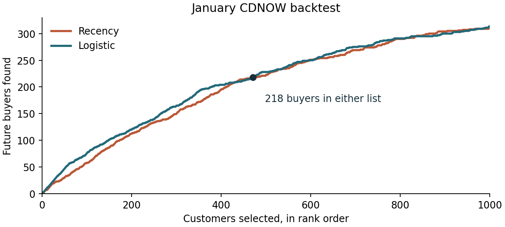

# Who comes back for another order?

The mailing list has 471 slots. Would it help to model the probability of another purchase, or would sorting customers by their last shopping date do just as well?

This backtest follows 2,357 people who first bought from CDNOW in the first quarter of 1997. The sample contains 6,919 transactions. A return means at least one purchase during the 90 days after the scoring date. Several orders on the same day count as a single shopping day.

| Scoring date | Future buyers in the 471 most recent shoppers | Future buyers in the model’s top 471 | Average precision, recency / model |
| --- | ---: | ---: | ---: |
| Oct 1, 1997 | 210 | 224 | 0.469 / 0.498 |
| Jan 1, 1998 | 218 | 218 | 0.458 / 0.543 |

In January, either list had a 46.3% repeat rate against 16.3% for the full cohort. The model’s advantage higher or lower in the ranking did not produce another buyer at the mailing cutoff. I’d keep recency as the operational benchmark. The next experiment would randomly withhold an offer from some customers on each list to see whether outreach actually changes purchases.

### How the backtest works

The July 1 snapshot provides the training features and the following 90 days provide its labels. The logistic model stays fixed across the October and January checks. Each snapshot uses the same existing customers. Past shopping days, recent activity, average daily basket, customer age, and recency are available at each cutoff. The SQL uses a strict boundary between history and future orders. Customer ID breaks ties in the ranking. Geography, campaign exposures, and opt-outs are absent from the file.

[Snapshot query](snapshot.sql) · [Backtest code](analyze.py) · [Full results](backtest.csv) · [Reproduction instructions](../../RUNNING.md)

Data from the Fader and Hardie CDNOW research sample. [Original sample notes](https://brucehardie.com/notes/022/RFM_summary_in_Excel.pdf) · [Data mirror](https://github.com/CamDavidsonPilon/lifetimes/tree/master/lifetimes/datasets)
