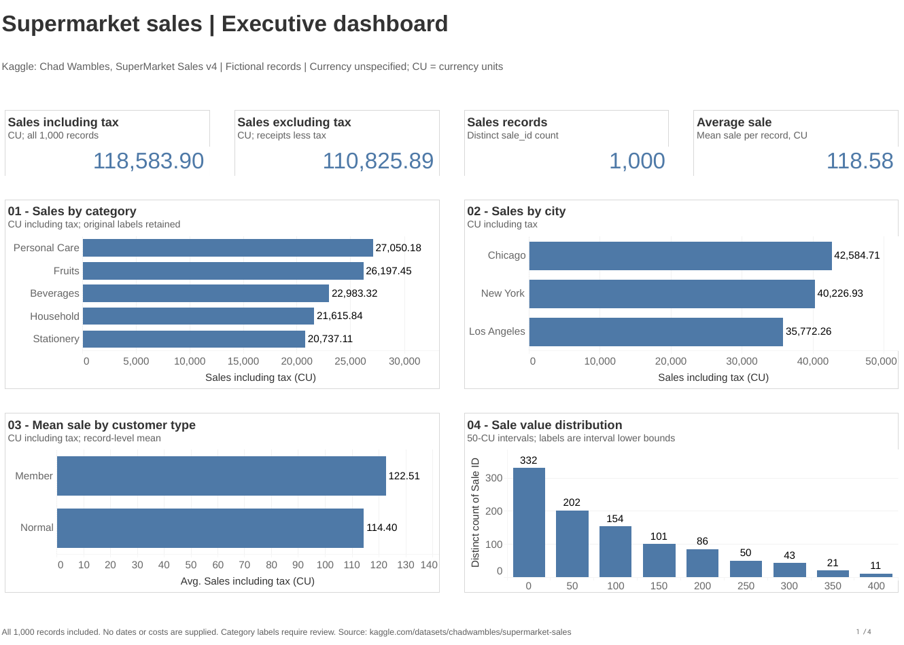

# Member baskets were larger. Is an offer worth testing?

Across 1,000 fictional supermarket sales, member records averaged **122.51 currency units** and other records averaged **114.40**. The 7.1% gap is enough to motivate an offer experiment. Without customer identifiers or dates, the file cannot establish whether joining changes a customer’s spending.

[Open the four-page dashboard and findings](dashboard.pdf) · [Download the Tableau workbook](dashboard.twbx)

The workbook contains three dashboards, eight analytical views, and four headline measures. Chicago leads the three cities with 42,584.71 in receipts. The branch comparison needs more care because branch A combines Chicago and New York while B contains Los Angeles alone.

The data-quality view also flags 810 records under a conventional product-to-category mapping. I’d verify the source taxonomy before using its category totals to choose a promotion. The original category labels stay visible in the workbook.

Run `python projects/supermarket-sales/check.py` from the repository root to independently recalculate the receipt total, member counts, and group means from the workbook’s embedded CSV.

[Independent arithmetic check](check.py) · [Source dataset by Chad Wambles, version 4](https://www.kaggle.com/datasets/chadwambles/supermarket-sales)
